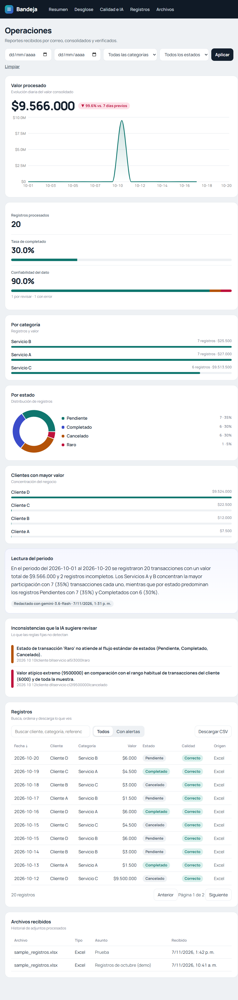

# Prueba técnica Junior — IA & Automatización

Pipeline que lee correos de un remitente autorizado, descarga sus adjuntos (PDF y Excel), los normaliza a un
esquema común, los guarda sin duplicados, genera un resumen con IA y los muestra en un dashboard.

```
Gmail (IMAP) ─▶ n8n Cloud ─▶ Excel / PDF parser ─▶ Validación (reglas) ─▶ Supabase (Postgres) ─▶ Dashboard Next.js (Vercel)
                    └──────────── Workflow 2: Gemini (resumen + inconsistencias) ───────────────┘
```

Diagrama detallado: [`docs/ARQUITECTURA.md`](docs/ARQUITECTURA.md).



## Tecnologías (y por qué)

| Capa | Herramienta | Motivo |
|---|---|---|
| Correo | Gmail por **IMAP** + contraseña de aplicación | Más simple y estable que OAuth (el token OAuth en modo "testing" expira a los 7 días) |
| Automatización | **n8n Cloud** (prueba gratuita) | Visual, fácil de explicar, nodos nativos para IMAP, Excel y PDF |
| Parseo y reglas | Code nodes (JavaScript) | Determinístico, barato, testeable (`tests/`) |
| IA | **Gemini 3.6 Flash** (`gemini-3.6-flash`) | Resumen y detección de inconsistencias semánticas |
| BD | **Supabase** (Postgres) | Persistencia hosteada gratis, constraints para evitar duplicados |
| Dashboard | **Next.js 14** + Recharts en **Vercel** | Server Components leen Supabase; sin API intermedia |

## Estructura

```
n8n/code/            Código de los Code nodes (lib.js + 7 scripts) — fuente de verdad, con tests
n8n/workflow_*.json  Workflows importables (se generan con scripts/build_workflows.js)
sql/schema.sql       Tablas, índices y políticas RLS
dashboard/           App Next.js
samples/             Excel y PDF de ejemplo (make_samples.py) para probar sin datos reales
tests/               Pruebas de la lógica (node --test)
docs/                Arquitectura, decisiones, preguntas de evaluador, prompts, validación
```

## Puesta en marcha

### 1. Supabase
1. Crea un proyecto en supabase.com (free).
2. SQL Editor → pega y ejecuta `sql/schema.sql`.
3. Project Settings → API: copia **Project URL**, la clave **anon** y la **service_role**.

**Opcional — aplicar el SQL desde tu terminal** (requiere `psql`): copia `.env.example` a `.env`, pon tu contraseña en `DATABASE_URL`
y ejecuta `bash scripts/apply_schema.sh` (o `bash scripts/apply_schema.sh --seed` para cargar también los datos de prueba).
La contraseña de la BD **nunca** va en el repo ni en el front.

### 2. Gmail (IMAP)
1. Activa la verificación en 2 pasos en tu cuenta de Google.
2. Crea una **contraseña de aplicación** (myaccount.google.com → Seguridad → Contraseñas de aplicaciones).
3. Gmail → Configuración → Reenvío y POP/IMAP → **Habilitar IMAP**.

### 3. n8n Cloud
1. **Credentials** (Credentials → Create):
   - `Gmail IMAP` (tipo IMAP): host `imap.gmail.com`, puerto `993`, SSL activado, usuario y contraseña de aplicación.
   - `Supabase service key` (tipo *Custom Auth*): en el campo JSON pega ambos headers. `apikey` identifica el proyecto y
     `Authorization` hace que PostgREST use el rol `service_role` y omita RLS; con solo `apikey` las escrituras fallan:
     ```json
     {
       "headers": {
         "apikey": "<service_role>",
         "Authorization": "Bearer <service_role>"
       }
     }
     ```
   - `Gemini API key` (tipo *Header Auth*): Name `x-goog-api-key`, Value = tu key de Google AI Studio.
2. **Importa** `n8n/workflow_1_ingesta.json` y `n8n/workflow_2_resumen_ia.json` (menú ⋯ → Import from file).
3. Los nodos HTTP ya apuntan a `https://ufrxxzrbakoaiqzzocds.supabase.co`; verifica la URL y selecciona la credencial en cada nodo.
4. En el nodo **Filtrar remitente y expandir adjuntos** cambia la constante `ALLOWED_SENDER`; haz lo mismo en el filtro
   `FROM` del trigger IMAP (Options → Custom Email Rules). El código compara la **dirección exacta**: un `From` como
   `xremitente@ejemplo.com` o `remitente@ejemplo.com.evil.com` no pasa.
5. Selecciona la credencial IMAP en el trigger y **activa** el workflow 1. Ejecuta el workflow 2 manualmente para el primer resumen.

### 4. Probar sin datos reales
Los archivos de muestra ya están en `samples/` (`sample_registros.xlsx` y `sample_reporte.pdf`).
Si quieres regenerarlos (requiere Python + `openpyxl`/`reportlab`):
```bash
pip install openpyxl reportlab
python samples/make_samples.py
```
Envía esos dos archivos como adjuntos, desde el remitente autorizado, a tu Gmail. Reenvíalos una segunda vez:
no debe aparecer ningún registro nuevo (anti-duplicados).

### 5. Dashboard
```bash
cd dashboard
cp .env.local.example .env.local        # completa SUPABASE_URL y SUPABASE_ANON_KEY
npm install
npm run dev                             # http://localhost:3000
```
Despliegue: importa el repo en Vercel, **Root Directory = `dashboard`**, y agrega las dos variables de entorno.

### 5b. Ver el dashboard sin n8n
- **Modo demostración:** si no defines `SUPABASE_URL` / `SUPABASE_ANON_KEY`, el dashboard muestra datos de ejemplo con un aviso.
- **Datos de prueba reales en Supabase:** ejecuta `sql/seed.sql` (se regenera con `node scripts/make_seed.js`). Carga el Excel de muestra
  procesado con la misma lógica de n8n y **deduplicado**: 20 filas únicas por **$9.566.000** (el archivo original tiene 21 filas).
  Si ya habías ejecutado el seed anterior, puedes volver a ejecutarlo: los `row_key` son los mismos (no duplica registros) y
  deja el resumen corregido. Vuelve a ejecutar también `sql/schema.sql` para crear la FK `ai_flags.row_key → records.row_key`.

### 6. Tests
```bash
npm test        # 31 pruebas sobre parseo, normalización, validación, deduplicación, filtro de remitente,
                # errores de extracción, workflow 2 y sincronía de los JSON con n8n/code
npm run check:workflows   # valida los dos JSON sin tener n8n instalado
```

## Cómo funciona la automatización

**Workflow 1 — Ingesta** (se dispara solo con cada correo nuevo, no leído):
1. *Email Trigger (IMAP)* trae correos no leídos del remitente y descarga adjuntos; los marca como leídos al recibirlos
   (ver limitaciones: si el workflow falla después, el correo no se reprocesa solo).
2. *Filtrar remitente y expandir adjuntos* valida la dirección **exacta** del `From` y emite un item por cada `.pdf`/`.xlsx`.
3. Rama paralela: registra el archivo en `processed_files` (historial) con reintentos.
4. *¿Es Excel?* → *Leer Excel* / *Leer PDF* (Extract from File) → *Normalizar*. Si el archivo está corrupto, el extractor
   no tumba el workflow: se guarda una fila con `quality_flag = 'error'` y el motivo.
5. *Validar y preparar fila*: reglas de calidad + `row_key`.
6. *Guardar en Supabase*: `INSERT … ON CONFLICT (row_key) DO NOTHING`, con 5 reintentos.

**Workflow 2 — Resumen con IA** (diario a las 8:00 o manual): lee registros, calcula métricas con código,
pide a Gemini el resumen y las inconsistencias, valida el JSON y guarda en `ai_summaries` / `ai_flags`.

## Anti-duplicados (3 capas)
1. Correos: el trigger solo lee `UNSEEN` y los marca como leídos al recibirlos (antes de que el workflow termine).
2. Archivos: `processed_files` tiene `UNIQUE (message_id, filename)`. El `message_id` sale de `metadata['message-id']`
   del IMAP (con fallback al UID y, por último, a `from|date|subject`).
3. Registros: `records.row_key` es `UNIQUE` y se construye por **contenido** (fecha, cliente, referencia, categoría,
   cantidad, valor, estado, normalizados). Reprocesar o reenviar el mismo Excel/PDF no inserta nada nuevo.
   Un mismo registro que llegue a la vez en Excel y PDF puede no colapsar si uno trae `referencia` y el otro `cantidad`
   (ver limitaciones).

## Uso de Inteligencia Artificial
- **Dónde:** (1) resumen ejecutivo en lenguaje natural; (2) detección de inconsistencias semánticas
  (clientes casi iguales, categorías raras, valores atípicos por cliente).
- **Por qué:** son tareas de lenguaje y de criterio difusas, donde las reglas fijas no llegan o no se pueden enumerar.
- **Dónde NO:** parseo, conversión de números/fechas, validación de campos y cálculo de métricas son código tradicional:
  más barato, exacto y reproducible. El LLM solo **redacta** con cifras que ya calculó el código y no calcula nada.
- **Si la API falla:** hay reintentos y un resumen de respaldo por plantilla (queda marcado como tal en el dashboard).
- **Privacidad:** el free tier de Gemini puede usar los datos para mejorar productos de Google; solo se envían
  cliente, categoría, fecha, valor y estado. No uses datos sensibles reales.

## Métricas adicionales del dashboard
Además de los mínimos (total, valor, categoría, estado y evolución), el panel muestra:
1. **Tasa de completado:** porcentaje de registros que terminaron sin alertas. Sirve para saber si el problema está en la
   recepción o en la calidad del dato, sin abrir los archivos uno por uno.
2. **Confiabilidad del dato:** porcentaje de registros `ok` frente a los que están `warning` o `error`. Si baja después de
   un cambio de formato en el proveedor, el panel lo hace visible de inmediato.
3. **Clientes con mayor valor:** concentración del negocio; ayuda a priorizar una revisión manual.
4. **Variación semanal:** compara los últimos 7 días con los 7 anteriores para detectar caídas o picos de operación.

La justificación completa está en [`docs/DECISIONES.md`](docs/DECISIONES.md).

## Limitaciones conocidas
- **n8n Cloud en prueba gratuita:** es temporal y con límite de ejecuciones; al vencer, los workflows dejan de correr.
  Los JSON están en el repo y el dashboard conserva los datos ya cargados en Supabase.
- **Supabase free** pausa proyectos tras ~1 semana sin actividad; **Vercel** y sus límites de uso gratuito aplican.
- El remitente se valida por el campo `From`, que se puede falsificar (mitigable con SPF/DKIM, fuera del alcance).
- n8n Cloud no tiene variables de entorno: `ALLOWED_SENDER` está dentro del nodo y también en el filtro `FROM` del trigger.
- El IMAP trigger consulta periódicamente (no es tiempo real).
- **El trigger IMAP marca el correo como leído antes de emitirlo al workflow.** Si el guardado falla de forma definitiva
  (p. ej., Supabase caído), el correo no se reintenta solo: revisa la ejecución en n8n y reenvía el archivo.
  Los nodos de escritura tienen reintentos para cubrir fallos transitorios.
- Dos filas del mismo origen con exactamente los mismos campos se consideran duplicado. Un mismo registro que llegue
  en Excel y en PDF puede no deduplicarse si uno trae `referencia` y el otro `cantidad` (campos específicos de cada origen).
- Formato `1.500` se interpreta como mil quinientos (convención colombiana).
- El dashboard y el workflow 2 leen como máximo los **5000** registros más recientes; si el volumen crece, habría que paginar.
- El parser de PDF asume bloques `Etiqueta: valor` o filas de 6 columnas; **debe ajustarse al PDF real**
  (`n8n/code/03_normalizar_pdf.js`, luego `npm run build:workflows`).
- Un PDF o Excel ilegible se guarda como una fila con `quality_flag = 'error'` (visible, pero cuenta en el total).

## Estado del proyecto (honestidad técnica)
Verificado: lógica de los Code nodes (**31 tests**), sincronía JSON ↔ `n8n/code` (`npm run check:workflows`),
`npm run build` del dashboard, conexión real del dashboard a Supabase (modo lectura) e **importación + ejecución
local en n8n 2.46.6** con los adjuntos de muestra (sin credenciales):
21 filas de Excel + 5 de PDF, `itemMatching` correcto, 1 error y 1 warning; workflow 2 con 2 filas (resumen + 1 flag)
y con 0 filas (resumen "No hay registros"). También se verificó el POST con `jsonBody` y `Prefer` contra un servidor
local: n8n envía JSON válido (sin doble codificación) y conserva el header.
**Verificado de punta a punta en la nube (2026-11-07):** correo real desde el remitente autorizado con un Excel adjunto
(21 filas leídas; 20 registros únicos, sin duplicados), escritura real en Supabase con `service_role`, resumen real de
Gemini 3.6 Flash (`used_fallback=false`) y dashboard mostrando 20 registros / **$9.566.000** y 2 inconsistencias.
El PDF de muestra se validó en local; antes de entregar conviene repetir la prueba con el PDF real del proveedor y ajustar
`03_normalizar_pdf.js` si su estructura no coincide.

## Demo y entrega
- **Dashboard local:** `cd dashboard && npm install && npm run dev` → `http://localhost:3000`.
- **Dashboard desplegado:** agregar aquí la URL de Vercel después del despliegue.
- **Repositorio:** agregar aquí la URL de GitHub (público o privado con acceso al evaluador).
- **Checklist de entrega:** [`docs/ENTREGA.md`](docs/ENTREGA.md).
- **Video sugerido (2-4 min):** mostrar el correo entrando, la ejecución de n8n, la fila nueva en Supabase y el dashboard
  actualizado; luego reenviar el mismo adjunto y mostrar que `records` no crece.
