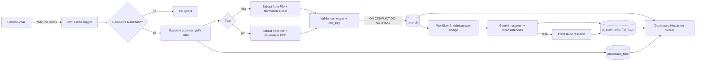

# Arquitectura



## Versión ASCII

```
Email ─▶ IMAP ─▶ n8n Workflow 1 ─┬─ Excel parser ─┐
                                 └─ PDF parser ───┴─▶ Validación ─▶ Supabase ─▶ Dashboard
                                                                       ▲
                          n8n Workflow 2 ─▶ Gemini (resumen/inconsistencias) ┘
```

## Modelo de datos
- `records`: esquema común. `row_key` UNIQUE (dedupe por contenido), `quality_flag` (ok/warning/error), `source_type`.
- `processed_files`: historial; `UNIQUE (message_id, filename)`. El `message_id` sale del header del correo (fallback al UID).
- `ai_summaries`: resumen + modelo + si fue plantilla.
- `ai_flags`: inconsistencias por `row_key`; `UNIQUE (row_key, motivo)` y FK a `records(row_key)` (la IA no puede inventar claves).
- Un Excel/PDF corrupto no detiene el workflow: genera una fila `quality_flag='error'` visible en el dashboard.
- n8n ejecuta `Validar`/`Guardar` **una vez por rama** (Excel y PDF), no las fusiona; no se añade `Merge` para no bloquear correos con un solo tipo de adjunto. `row_key` UNIQUE evita duplicados entre ramas.

## Generación de los workflows
`n8n/code/*.js` es la fuente de verdad. `npm run build:workflows` genera los dos JSON y
`npm run check:workflows` verifica que estén sincronizados (sin editar el JSON a mano).

## Seguridad
- RLS activo en todas las tablas; el dashboard usa la clave `anon` (solo lectura) y solo desde el servidor.
- La `service_role` vive solo en las credenciales de n8n. Ningún secreto en el repo.
